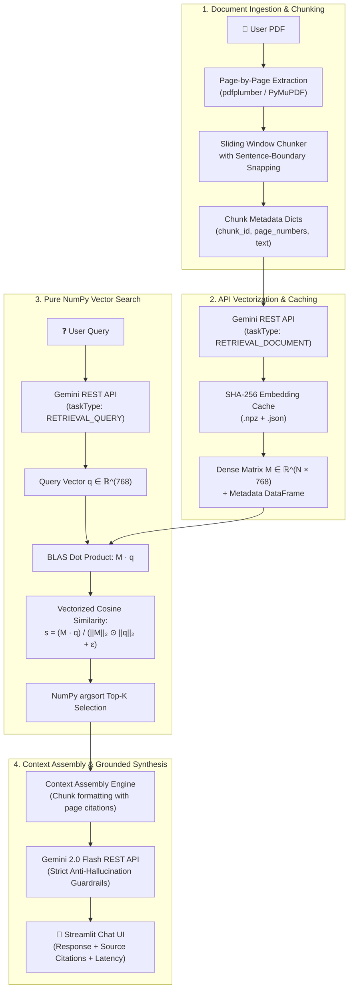

# ⚡ Framework-Free NumPy RAG Engine

A production-grade, framework-free Retrieval-Augmented Generation (RAG) system built from first principles in pure Python and NumPy.

Zero LangChain. Zero LlamaIndex. Zero Vector Databases. Pure linear algebra and direct REST API integrations.

---

## 🏛️ System Architecture



---

## 🚀 Key Engineering Highlights

- **Pure Mathematical Retrieval**: No external vector search library (FAISS, Chroma, Pinecone). All vector operations are performed in pure NumPy utilizing SIMD/BLAS matrix multiplications (`np.dot`).
- **Sentence-Boundary Aware Chunking**: Unlike naive chunkers that split words mid-sentence, our sliding window algorithm inspects the tail of each window to snap to the nearest punctuation boundary (`.`, `!`, `?`), preserving semantic integrity.
- **Asymmetric Vector Embeddings**: Utilizes Google's `text-embedding-004` model with explicit `taskType` differentiation: `RETRIEVAL_DOCUMENT` for index chunks and `RETRIEVAL_QUERY` for runtime queries.
- **Parallel Memory Architecture**: Metadata is kept in a Pandas DataFrame, while high-dimensional dense vectors reside in contiguous C-order `float32` NumPy arrays to avoid object-wrapping performance degradation.
- **Persistent SHA-256 Cache Layer**: Automatically computes the SHA-256 checksum of uploaded documents and serializes computed matrices into compressed `.npz` and `.json` formats, eliminating redundant API calls.

---

## 🧮 Mathematical Formulation

Given a query vector $\mathbf{q} \in \mathbb{R}^{d}$ and a document matrix $\mathbf{D} \in \mathbb{R}^{N \times d}$ representing $N$ document chunks embedded in $d$-dimensional space ($d = 768$):

$$\text{similarity}(\mathbf{q}, \mathbf{d}_i) = \frac{\mathbf{d}_i \cdot \mathbf{q}}{\|\mathbf{d}_i\|_2 \|\mathbf{q}\|_2 + \epsilon}$$

In vectorized NumPy:
```python
dot_products = np.dot(doc_matrix, query_vec)      # Shape: (N,)
query_norm   = np.linalg.norm(query_vec)          # Scalar
doc_norms    = np.linalg.norm(doc_matrix, axis=1) # Shape: (N,)
similarities = dot_products / (doc_norms * query_norm + 1e-10)

# Top-K extraction
top_k_indices = np.argsort(similarities)[-k:][::-1]
```

---

## 📂 Project Structure

```
numpy-rag-engine/
├── app.py                    # Streamlit interactive chat interface
├── config.py                 # System constants, models, and configuration
├── requirements.txt          # Python dependencies
├── .env.example              # Template for API credentials
├── .gitignore
├── README.md                 # Technical blueprint & documentation
│
├── core/
│   ├── __init__.py
│   ├── chunker.py            # PDF parsing & sliding window chunking with sentence snapping
│   ├── embedder.py           # Gemini REST API vectorizer & batch coordinator
│   ├── retriever.py          # Vectorized cosine similarity & top-k ranking in NumPy
│   └── generator.py          # Prompt assembly & Gemini 2.0 Flash text generation
│
├── utils/
│   ├── __init__.py
│   ├── cache.py              # SHA-256 based .npz/.json caching layer
│   └── helpers.py            # Text normalization, hashing, and logging
│
├── data/                     # Uploaded documents directory
└── cache/                    # Compressed embedding cache
```

---

## 🛠️ Getting Started

### 1. Clone & Install Dependencies
```bash
git clone https://github.com/Soumyajit-Pal/numpy-rag-engine.git
cd numpy-rag-engine
pip install -r requirements.txt
```

### 2. Configure Environment Variables
Copy `.env.example` to `.env` and insert your Gemini API key (from [Google AI Studio](https://aistudio.google.com/)):
```bash
cp .env.example .env
```
Or simply enter the API key directly in the Streamlit UI sidebar.

### 3. Run the Application
```bash
streamlit run app.py
```

---

## 🎯 Technical Interview Talking Points

1. **Why not LangChain / LlamaIndex?**
   - Abstraction libraries hide critical system bottlenecks (network retries, memory serialization, chunk truncation). Building from scratch demonstrates deep understanding of context injection, prompt engineering, and raw HTTP API lifecycles.
2. **Why NumPy over FAISS for moderate datasets?**
   - For datasets up to tens of thousands of chunks ($< 50\text{MB}$ in memory), single-instruction matrix-vector products (`np.dot` backed by OpenBLAS/MKL) calculate full cosine similarity scans in $< 1\text{ms}$, removing the operational complexity of vector database infrastructure.
3. **Chunking Tradeoffs**:
   - Fixed-size chunking leads to severed sentence fragments. Our sliding window algorithm dynamically scans the final 25% of the window to snap to punctuation boundaries, preventing context degradation at chunk seams.
